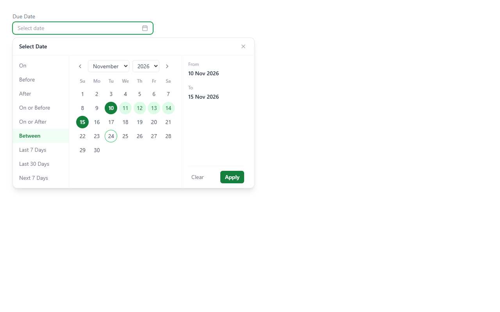
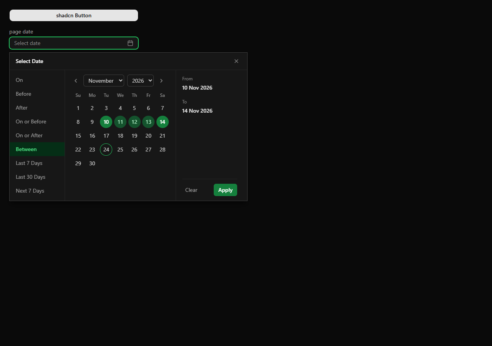

# react-date-filter-picker

A compact React **date filter** field: pick a mode (On, Before, After, On or Before, On or After, Between, or a quick range), choose dates on a calendar, and get back a typed value plus a ready-made label.

| Light | Dark |
|---|---|
|  |  |

More screenshots (brand colours, dialogs, drawers, mobile) are in [`screenshots/`](https://github.com/Nandan0003/react-date-filter-picker/tree/main/screenshots).

- **Zero runtime dependencies.** Only `react` and `react-dom` as peers (React 18 or 19).
- **No framework requirements.** Plain CSS, so no Tailwind or shadcn/ui setup is needed. It also works alongside both.
- **Works inside modals.** It is usable inside Radix / shadcn Dialog, Sheet, AlertDialog and vaul Drawer. Escape closes the picker first, not the dialog.
- **TypeScript types included.** Ships ESM and CommonJS builds.
- **Light and dark themes.** It follows your app's dark mode automatically by recognising the common dark-mode markers (`.dark`, `data-theme`, `data-bs-theme`, `data-mui-color-scheme`), or you can force a theme with a prop.
- **Themable.** Uses `--dfp-*` CSS variables, which you can set globally or per instance, or set one `accentColor`.
- **Responsive.** Three-column popover on desktop, stacked layout on mobile. It opens above or below the field depending on available space.
- **Accessible.** The label is linked to the trigger, the popover is a labelled `dialog`, focus moves into the popover when it opens and back to the field when it closes, and the picker is fully keyboard-operable.
- **Includes a `"use client"` directive** for the Next.js App Router.

## Install

```bash
npm install react-date-filter-picker
# or
yarn add react-date-filter-picker
# or
pnpm add react-date-filter-picker
```

## Usage

Import the stylesheet once, for example in your app entry, then use the component:

```tsx
import { useState } from "react";
import { DateFilterPicker, type DateFilterValue } from "react-date-filter-picker";
import "react-date-filter-picker/styles.css";

export function Filters() {
  const [dueDate, setDueDate] = useState<DateFilterValue | null>(null);

  return (
    <DateFilterPicker
      label="Due Date"
      value={dueDate}
      onChange={setDueDate}
    />
  );
}
```

There is nothing else to configure: no Tailwind content paths, no PostCSS, and no shadcn setup.

### With React Hook Form

```tsx
<Controller
  control={control}
  name="dueDate"
  render={({ field }) => (
    <DateFilterPicker label="Due Date" value={field.value} onChange={field.onChange} />
  )}
/>
```

## The value

`onChange` fires when the user clicks **Apply** (with the value) or **Clear** (with `null`). Picking dates without clicking Apply does not fire it.

```ts
interface DateFilterValue {
  filter: DateFilterOption; // "On" | "Before" | ... | "Next 7 Days"
  dates: Date[];
  label: string;            // e.g. "06 Jul 2026 - 14 Jul 2026"
}
```

| `filter` | `dates` |
|---|---|
| `On`, `After`, `On or After` | `[date]` |
| `Before`, `On or Before` | `[date]` |
| `Between` | `[from, to]` (always in order) |
| `Last 7 Days`, `Last 30 Days`, `Next 7 Days` | `[from, to]`, inclusive of today |

Dates are local-time `Date` objects at midnight. Convert them to strings or UTC yourself when sending them to an API.

## Props

| Prop | Type | Default | Description |
|---|---|---|---|
| `value` | `DateFilterValue \| null` | `null` | Controlled value. |
| `onChange` | `(next: DateFilterValue \| null) => void` | — | Called on Apply or Clear. |
| `label` | `string \| null` | `"Date"` | Label above the field. `null` hides it. |
| `placeholder` | `string` | `"Select date"` | Trigger text when empty. |
| `options` | `readonly DateFilterOption[]` | all modes | Which modes to show, and in what order. |
| `defaultFilter` | `DateFilterOption` | `"Between"` | Mode selected when the field is empty. |
| `isLoading` | `boolean` | `false` | Shows a skeleton instead of the trigger. |
| `disabled` | `boolean` | `false` | Disables the trigger. |
| `title` | `string` | `"Select Date"` | Popover heading. |
| `applyLabel` / `clearLabel` | `string` | `"Apply"` / `"Clear"` | Button text. |
| `theme` | `"auto" \| "light" \| "dark" \| "system"` | `"auto"` | Colour theme. `auto` follows your app's dark mode. See [Dark mode](#dark-mode). |
| `accentColor` | `string` | — (green theme) | Brand colour; every shade is derived from it. Any CSS colour, e.g. `"#2563eb"` or `"var(--primary)"`. See [Brand colour](#brand-colour). |
| `className` | `string` | — | Extra class on the field wrapper. `--dfp-*` variables set here also apply to its popover. |
| `popoverClassName` | `string` | — | Extra class on the popover. |
| `id` / `name` | `string` | auto / — | Attributes for the trigger button. |

### Other exports

- `DATE_FILTER_OPTIONS`: readonly array of every mode.
- `formatDate(date)`: formats a date as `dd Mon yyyy`, the same format the labels use.
- Types: `DateFilterValue`, `DateFilterOption`, `DateFilterPickerProps`, `DateFilterTheme`.

### TypeScript

Type declarations ship with the package, for both `import` and `require`, so there is no separate `@types` package to install. Import types with `import type`:

```ts
import type { DateFilterValue, DateFilterOption, DateFilterPickerProps } from "react-date-filter-picker";
```

Example of limiting the modes:

```tsx
<DateFilterPicker
  label="Created"
  options={["On", "Between", "Last 7 Days", "Last 30 Days"]}
  value={value}
  onChange={setValue}
/>
```

## Dark mode

The picker has a built-in dark theme. With the default `theme="auto"`, it turns dark automatically when your app is in dark mode, so most apps need no setup. It recognises these markers on any ancestor, usually `<html>`:

| Marker | Used by |
|---|---|
| `class="dark"` | shadcn/ui, Tailwind's class strategy, next-themes |
| `data-theme="dark"` | daisyUI and many others |
| `data-bs-theme="dark"` | Bootstrap 5.3+ |
| `data-mui-color-scheme="dark"` | MUI (CSS variables mode) |

`auto` deliberately ignores the operating-system setting: an app without a dark mode keeps a light picker even if the user's OS is dark. Other options:

```tsx
<DateFilterPicker theme="dark" />    // always dark
<DateFilterPicker theme="light" />   // always light, even inside a dark app
<DateFilterPicker theme="system" />  // follow the OS setting (prefers-color-scheme)
```

Notes:

- **Dark section inside a light page:** a `<div class="dark">` inside a light page works too. The popup is rendered in `<body>`, outside that div, but it still gets the dark colours.
- **Native controls:** the month and year dropdowns and scrollbars switch to dark with the picker.
- **Brand colours:** `accentColor` and `--dfp-accent` work in both themes. If the accent is too close to the dark background, the picker lightens the text that uses it so it stays readable.
- **Other dark-mode markers:** if your app uses a different marker, pass `theme="dark"` when it is active, or set the dark variables under your own selector (see below).

### Customising the dark colours

Set any `--dfp-*` variable under your dark selector. Variables set on `:root` apply to both themes.

```css
.dark {
  --dfp-surface: #0a0a0a;
  --dfp-border: #333333;
}
```

Default dark colours: background `#171717`, borders `#404040`, dividers and hover `#262626`, text `#d4d4d4` / `#e5e5e5` / `#fafafa`, muted text `#a3a3a3` / `#8a8a8a`. The green selection stays `#15803d`; the active mode is `#4ade80` on `#052e16`, and the range is `#bbf7d0` on `#14532d`.

## Brand colour

The picker ships with a green theme. To use your own colour, give it a single **accent**. The hover, disabled, active-mode, range, today-ring and focus-ring shades are all derived from it.

```tsx
// Per instance, as a prop
<DateFilterPicker accentColor="#2563eb" value={value} onChange={setValue} />
```

```css
/* Or for every picker, in CSS */
:root { --dfp-accent: #2563eb; }
```

**Light accents are handled automatically.** If white text would be hard to read on your accent (yellow, lime, light grey, …), the picker:

- uses dark text on the accent;
- darkens the active-mode text, range text, focus ring and today ring so they stay readable.

`--dfp-accent-contrast` sets the text colour on the accent, such as the Apply button and selected days, if you want a specific one. It defaults to white, or to dark text for light accents:

```css
:root { --dfp-accent: #facc15; --dfp-accent-contrast: #422006; }
```

### Follow your app's primary colour (shadcn/ui)

The picker does **not** follow your app's theme automatically: shadcn's default primary is near-black, and other apps use `--primary` for unrelated things. If you want it to, add one line. The picker then also follows your light and dark themes.

```css
/* shadcn/ui with Tailwind v4: --primary holds a full colour (oklch) */
:root {
  --dfp-accent: var(--primary);
  --dfp-accent-contrast: var(--primary-foreground);
}

/* shadcn/ui with Tailwind v3: --primary holds bare HSL numbers such as "221 83% 53%" */
:root {
  --dfp-accent: hsl(var(--primary));
  --dfp-accent-contrast: hsl(var(--primary-foreground));
}
```

You can also pass it per instance: `<DateFilterPicker accentColor="var(--primary)" />`.

Notes:

- Derived shades use CSS `color-mix()`, which works in Chrome/Edge 111+, Safari 16.2+ and Firefox 113+. In older browsers, only the main colour and focus ring follow the accent; the other shades keep the built-in green.
- An explicit shade variable set on the field, e.g. `className="[--dfp-range:#e0f2fe]"`, still wins over the derived value.

## Theming

Every colour, radius and size is a CSS variable. You can override them in three places:

```css
/* 1. Globally */
:root {
  --dfp-primary: #2563eb;
  --dfp-primary-hover: #1d4ed8;
  --dfp-range: #dbeafe;
}

/* 2. Per instance: put a class on the field with className="blue-picker".
      Variables set on the field are carried over to its popover automatically. */
.blue-picker {
  --dfp-primary: #2563eb;
}
```

```tsx
// 3. Per instance with Tailwind arbitrary properties
<DateFilterPicker className="[--dfp-primary:#2563eb] [--dfp-range:#dbeafe]" />
```

| Variable | Default (light theme) | Used for |
|---|---|---|
| `--dfp-accent` | unset | Brand colour; when set, every shade below that is marked † is derived from it |
| `--dfp-accent-contrast` | white (dark for light accents) | Text on the accent (used only when an accent is set) |
| `--dfp-primary` † | `#15803d` | Selected day, Apply button |
| `--dfp-primary-hover` † | `#166534` | Apply hover |
| `--dfp-primary-disabled` † | `#86efac` | Apply when disabled |
| `--dfp-primary-contrast` † | `#ffffff` | Text on primary |
| `--dfp-primary-soft` / `--dfp-primary-soft-text` † | `#f0fdf4` / `#15803d` | Active mode in the sidebar |
| `--dfp-range` / `--dfp-range-text` † | `#dcfce7` / `#166534` | Days inside a range |
| `--dfp-today-ring` † | `#22c55e` | Today outline |
| `--dfp-focus-ring` † | `#16a34a` | Open trigger border, keyboard focus outline |
| `--dfp-surface` | `#ffffff` | Field and popover background |
| `--dfp-border` / `--dfp-border-hover` | `#e5e7eb` / `#d1d5db` | Field and control borders |
| `--dfp-divider` | `#f3f4f6` | Lines inside the popover |
| `--dfp-hover` / `--dfp-hover-soft` | `#f3f4f6` / `#f9fafb` | Hover backgrounds |
| `--dfp-heading` / `--dfp-text-strong` / `--dfp-text` | `#111827` / `#1f2937` / `#374151` | Text |
| `--dfp-text-muted` / `--dfp-text-subtle` | `#6b7280` / `#9ca3af` | Labels, placeholders, weekdays |
| `--dfp-skeleton` | `rgba(107,114,128,.2)` | Loading skeleton |
| `--dfp-radius` / `--dfp-popover-radius` | `0.5rem` / `0.75rem` | Corner radius |
| `--dfp-font-family` | system sans-serif stack | Font. Set it to `initial` to use your app's font. |
| `--dfp-font-size` | `0.875rem` | Base text size |
| `--dfp-popover-width` | `620px` | Desktop popover width (capped at viewport − 1rem) |
| `--dfp-z-index` | `50` | Popover stacking |
| `--dfp-shadow` | Tailwind `shadow-lg` | Popover shadow |
| `--dfp-color-scheme` | `light` / `dark` | Native control colours (selects, scrollbars) |

Every element also has a stable `dfp-*` class, such as `.dfp-trigger`, `.dfp-popover`, `.dfp-day--selected` and `.dfp-apply`, if you need deeper overrides.

### Using your app's font

By default the picker uses the system sans-serif stack, the same one as Tailwind's `font-sans`. To use your app's font instead, set the variable to `initial`. This works globally and per instance:

```css
:root { --dfp-font-family: initial; }
```

```tsx
<DateFilterPicker className="[--dfp-font-family:initial]" />
```

You can also name a font directly, e.g. `--dfp-font-family: "Inter", sans-serif`. Avoid `inherit` on a single field: for CSS variables, `inherit` copies the variable from the parent element instead of the parent's font.

## Tailwind CSS and shadcn/ui

You don't need either. If your app uses them, the picker works alongside them:

- Its styles use only `dfp-*` classes and `--dfp-*` variables, so they never touch shadcn's theme variables or your Tailwind styles.
- Tailwind's preflight reset does not affect the picker.

**Overriding styles with Tailwind utilities.** By default the package CSS is un-layered, so it wins over Tailwind utilities that set the same property. For example, `popoverClassName="z-[70]"` would have no effect. You have three options:

1. Use the CSS variables (recommended), e.g. `className="[--dfp-z-index:70]"`.
2. Use Tailwind's important modifier, e.g. `popoverClassName="z-[70]!"` (v4) or `!z-[70]` (v3).
3. With Tailwind v4, load the stylesheet into Tailwind's `components` layer from your CSS entry instead of importing it in JS. Utilities then override it normally, and it still overrides preflight:

   ```css
   /* app.css */
   @import "tailwindcss";
   @import "react-date-filter-picker/styles.css" layer(components);
   ```

## Inside dialogs, sheets and drawers

Modal libraries such as Radix / shadcn Dialog, Sheet, AlertDialog and vaul Drawer block clicks and focus outside their content. When the field sits inside an element with `role="dialog"`, `role="alertdialog"` or a native `<dialog>`, the popover renders inside that element instead of `document.body`:

- it stays clickable and focusable
- it is positioned correctly even when the dialog uses CSS transforms

Escape closes the picker without closing the dialog; a second Escape closes the dialog as usual. Outside a modal, the popover renders in `document.body`.

## Keyboard

| Key | Action |
|---|---|
| Enter / Space on the field | Open the picker. Focus moves to the active mode. |
| Tab / Shift+Tab | Move between modes, month and year selects, days, Clear and Apply. |
| Enter / Space | Choose the focused mode or day, or press the focused button. |
| Escape | Close without applying. Focus returns to the field. |

## Behaviour notes

- The popover closes on outside click, Escape, page scroll, or window resize. Closing without Apply discards the draft.
- For **Between**, the first click sets the start and the second sets the end. Clicking an earlier date second swaps them.
- Quick ranges are computed when chosen, and the calendar is read-only for them.
- Today is outlined on the calendar.

## Compatibility

**Tested.** Each setup below installed the packed package with `npm install`, built for production, and was checked with mouse and keyboard in Chrome.

| Setup | Versions |
|---|---|
| React | 18.3 and 19.3 |
| Bundler | Vite 8, TypeScript (strict) |
| Plain React app | no Tailwind, no shadcn/ui |
| Tailwind CSS | v4 |
| shadcn/ui | Dialog, Sheet, AlertDialog (Radix), Drawer (vaul) |

**Browsers.** The picker uses standard CSS. Brand-colour shading uses `color-mix()`, which is available in Chrome/Edge 111+, Safari 16.2+ and Firefox 113+. In older browsers the accent still applies to the main colour and focus ring, and the other shades keep the built-in green. Automated testing so far has been in Chrome only.

**Not yet tested:**

- Firefox and Safari
- Next.js and server rendering (the bundle includes a `"use client"` directive)
- Tailwind CSS v3
- pnpm and yarn installs
- Jest / Vitest with jsdom

Reports are welcome in [issues](https://github.com/Nandan0003/react-date-filter-picker/issues).

## Links

- Source: https://github.com/Nandan0003/react-date-filter-picker
- Issues: https://github.com/Nandan0003/react-date-filter-picker/issues
- Changelog: [CHANGELOG.md](https://github.com/Nandan0003/react-date-filter-picker/blob/main/CHANGELOG.md)

## License

[MIT](https://github.com/Nandan0003/react-date-filter-picker/blob/main/LICENSE) © Nandan Kumar M
